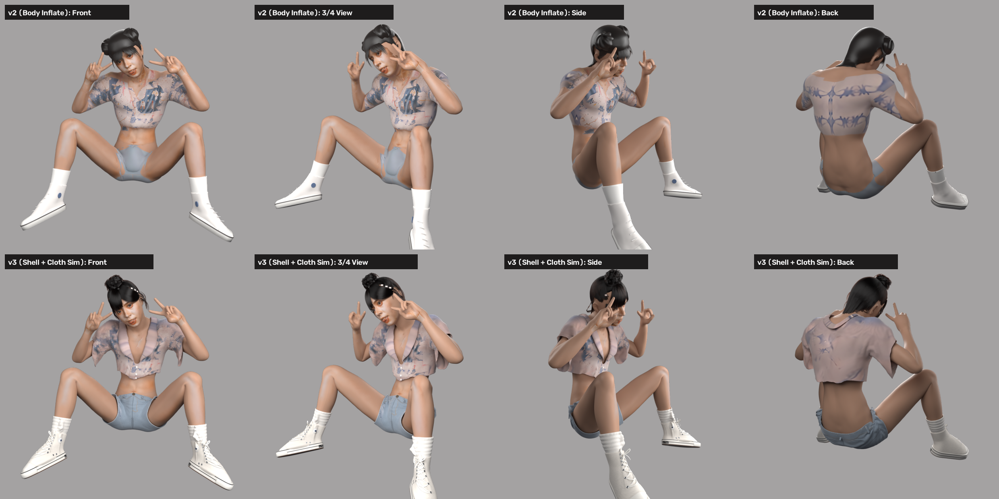
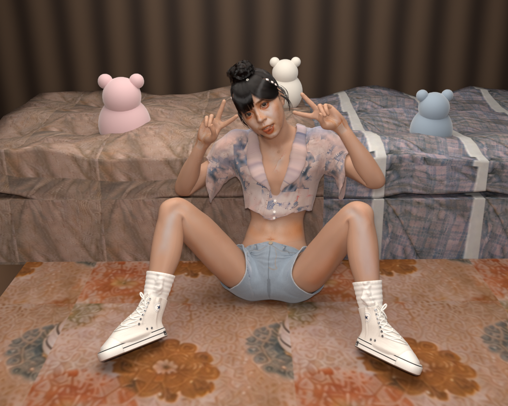
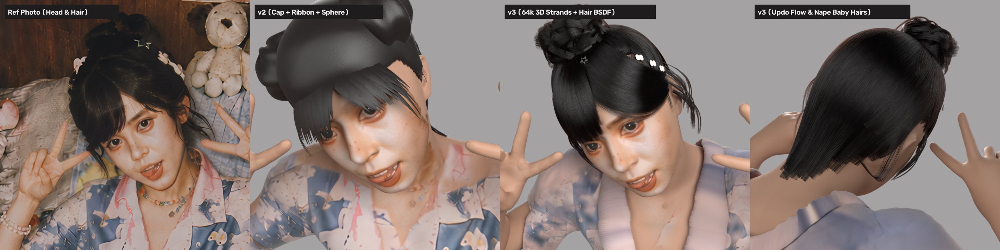
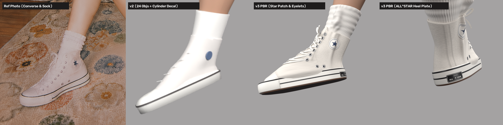
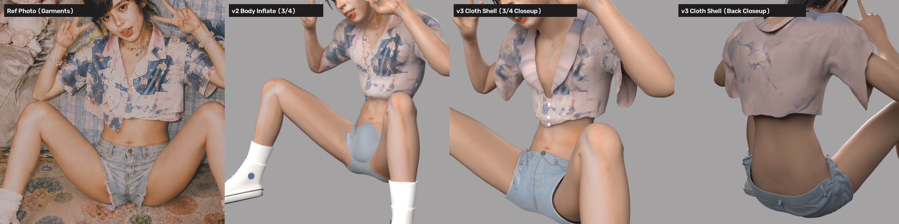

# 单图 3D 角色与卧室场景重建 · `q004-base`

> 从**一张**拍立得实拍照片，重建出带独立衣物壳体、6.4 万根曲线毛发、PBR 帆布鞋的可多视角检视 3D 角色，
> 以及与之严丝合缝的卧室场景。全流程脚本化、可一键复现，约 2 分钟跑完。

---

## 效果

| v2（体表膨胀 + 多边形发帽）vs v3（独立布料壳 + 3D 发丝） |
| :---: |
|  |

| 场景复刻 | 毛发微距 |
| :---: | :---: |
|  |  |

| 帆布鞋与白袜（PBR 四通道） | 服装微距 |
| :---: | :---: |
|  |  |

---

## 管线

```
输入照片 (2× 超分)
  │
  ├─ M1-A  前景分割 + 可微体态精修            v2_segment_and_fit.py      [env: mhr]
  ├─ M1-B  原生 MHR LOD0 评估 + 解剖语义分区   v2_prepare_mesh.py         [env: mhr0]
  │        └→ 数据契约 mesh_lod0_v2.npz  (73,639v / 147,274f)
  ├─ M2    屏幕 Z-Buffer 反投影 + 4K 语义图集   v2_build_atlas.py          [env: mhr]
  │
  ├─ G1    独立衣物壳体裁剪 + CLOTH 物理模拟    v3_simulate_garments.py    [Blender]
  ├─ G2    三通道 4K 服装贴图解耦              v3_build_garment_tex.py    [env: mhr]
  ├─ G2b   鞋袜非重叠 UV + 4K/2K PBR 贴图      v3_build_shoe_tex.py       [env: mhr]
  ├─ G3    角色 11 视角 + 微距特写渲染          v3_render_char.py          [Blender]
  ├─ G4    卧室场景复刻                        v3_build_scene.py          [Blender]
  └─ G5    对比看板合成                        v3_make_sheets.py          [env: mhr]
```

技术底座：[SAM 3D Body (DINOv3)](https://github.com/facebookresearch/sam-3d-body) 提供姿态与体态先验，
[MHR (Momentum Human Rig)](https://github.com/facebookresearch/MHR) 提供 127 关节骨骼与 LOD0 细分网格，
[Blender 4.5](https://www.blender.org/) Cycles 负责渲染。

---

## 目录

```
scripts/           管线脚本（v2 主干 + v3 解耦升级 + legacy_v1 早期原型）
docs/
  HANDOVER.md      交接文档：坐标系约定、数据契约、7 项根因诊断与量化改善
  OPTIMIZATION_SPEC.md  优化技术规范
work/q004-base/
  v2/  v3/         各阶段产物的统计 JSON（几何/贴图二进制见 .gitignore）
  renders/         渲染结果与对比看板
```

仓库**只包含代码、文档、渲染图与统计指标**。以下几类按 `.gitignore` 排除，需自行准备或重新生成：

| 路径 | 说明 |
| :--- | :--- |
| `envs/` `mamba/` | 两个 Python 虚拟环境 |
| `models/` `repos/` | 模型权重与 MHR 官方仓库（含大体积资产与第三方许可） |
| `work/**/scene/*.png` | 输入实拍照片 |
| `work/**/*.npz` `work/**/tex/` | 网格、参数包、4K/8K 贴图等中间产物 |

---

## 快速开始

### 1. 环境

本工程刻意拆成两个 Python 环境，**不要合并**：

| 环境 | 位置 | 关键依赖 | 用途 |
| :--- | :--- | :--- | :--- |
| `mhr` | `envs/mhr/Scripts/python.exe` | `torch 2.14.1+cu126`、`opencv 5.0`、`mediapipe 1.2.2`、`scipy 1.17`、`trimesh` | 分割拟合、图集、拼图 |
| `mhr0` | `envs/mhr0/python.exe`（**注意在根目录**） | `torch 2.14.1`(CPU)、`pymomentum`(C++ 拓展)、`mhr 1.0.1` | 原生 LOD0 评估 |
| Blender | `Blender 4.5 LTS` | Cycles（优先 OptiX，回退 CUDA/CPU） | 物理模拟与渲染 |

> ⚠️ `mhr0` 是 conda 环境，`pymomentum` 依赖的 DLL 在 `envs/mhr0/Library/bin`，
> 运行前必须把该路径插到 `PATH` 最前面，否则报 `ImportError: DLL load failed`。

### 2. 备齐输入

```
work/q004-base/scene/gpen_2x.png     # 你的实拍照片（建议经 GPEN 2× 增强，2804×2244）
work/q004-base/scene/tex/            # 场景贴图：carpet / duvet / plaid / wood
work/q004-base/fit/params.npz        # SAM 3D Body 初始拟合（见下）
```

`fit/params.npz` 由 SAM 3D Body 官方推理生成，或直接复用其 demo 输出。

### 3. 一键运行

```bash
# 完整流程（约 2 分钟）
envs/mhr/Scripts/python.exe scripts/v3_run_all.py

# 复用已烘焙的物理布料壳体
envs/mhr/Scripts/python.exe scripts/v3_run_all.py --skip-sim

# 只重跑渲染与看板
envs/mhr/Scripts/python.exe scripts/v3_run_all.py --skip-sim --skip-tex --skip-shoe-tex
```

分模块命令见 [`docs/HANDOVER.md`](docs/HANDOVER.md) 第 5.3 节。

---

## 核心数据契约

所有几何、语义与相机参数由 `work/q004-base/v2/mesh_lod0_v2.npz` 唯一定义：

| 字段 | 形状 | 含义 |
| :--- | :--- | :--- |
| `v` / `faces` | `(73639,3)` / `(147274,3)` | LOD0 顶点（SAM 相机系，米）与三角面 |
| `tex` / `tfaces` | `(75666,2)` / `(147274,3)` | UV 坐标与纹理面索引 |
| `rest_v` | `(73639,3)` | T-pose 解剖顶点（cm），用于姿态无关的区域切分 |
| `pred_joint_coords` / `joint_names` | `(127,3)` / `(127,)` | 127 关节坐标与语义名 |
| `cloth_region` | `(73639,)` | 顶点级着装语义：`0` 皮肤 / `1` 短袖 / `2` 短裤 / `3` 鞋袜 |
| `is_face_core` / `is_oral_eye` | `(73639,)` | 五官保护区 / 眼球与口腔内腔豁免标记 |
| `vertex_inflate` | `(73639,)` | 蒙皮安全体积外推量（米） |
| `head_center` / `head_right` / `head_fwd` / `head_up` | `(3,)` | 头部局部正交基 |

坐标系变换（MHR → SAM → Blender）与相机标定公式见 `docs/HANDOVER.md` 第 3 节。

---

## 关键量化指标

| 指标 | 数值 |
| :--- | :--- |
| 网格规模 | 原生 LOD0，73,639 顶点 / 147,274 面 |
| 头部侧倾标定 / 正交基误差 | 38.52° / 0.00 |
| 手腕体积外推（修复 24mm 鼓包） | 0.000 mm |
| 图集 | 4096²，UV 覆盖 92.47%，有效观测 33.89%，28.66 s |
| 小腿截面宽度（修体态） | 左 94.19→84.24 px，右 91.52→82.61 px |
| 布料间隙 | 衬衫 p50 9.93 mm / max 85.36 mm；短裤 p50 8.50 mm |
| 毛发 | ~64,000 根 `hair_curves`，Chiang-2016 黑色素 Principled Hair BSDF |
| 鞋袜 | 4 个流形网格，UV 重叠率 0.00%，鞋 4K 四通道 / 袜 2K 三通道 PBR |

---

## 已知局限

1. **面部神态**：口腔与舌部在大特写下仍呈破碎体块，唇齿结构不成立；眼下妆容晕染偏重。
2. **皮肤着色**：手背、手臂有偏强的高光，观感偏蜡质。
3. **布料实体感**：衬衫印花偏淡、有半透明感，翻领辨识度不足。
4. **背面衣褶**：背部为正面布料的四向镜像无缝合成，缺少倚靠压迫产生的高频褶皱（可引入单目法线扩散模型补足）。
5. **玩偶与家具**：场景道具为简化体块，未做五官与布料褶皱。
6. **体态拟合**：右前臂实测 48.71 px vs 目标 67 px、小腿距目标仍差约 5 px，未完全收敛。
7. **未做骨骼导出**：当前产物为固定姿态网格，尚未导出 FBX/glTF 绑定用于引擎。

---

## 第三方组件与声明

本仓库**不包含**任何模型权重或第三方资产，运行时需自行获取：

- **MHR** — Meta，Apache-2.0，需自行下载官方 `assets`（rig / 参数化 / blendshapes）
- **SAM 3D Body (DINOv3)** — Meta，权重受其各自许可约束，请勿再分发
- **MediaPipe Selfie Segmenter / GPEN** — Google / ModelScope，按各自许可使用

完整清单与获取方式见 [`NOTICE.md`](NOTICE.md)。

代码以 MIT 许可发布，详见 [`LICENSE`](LICENSE)；第三方组件的许可与分发限制见 [`NOTICE.md`](NOTICE.md)。

> **肖像权提示**：`work/q004-base/renders/` 下的渲染图包含由真人照片重建的面部形象。
> 若仓库公开，请确认已获得被摄者同意；也可以删除该目录后再发布。
