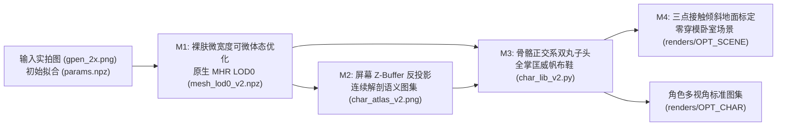
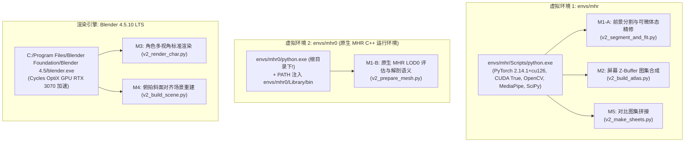
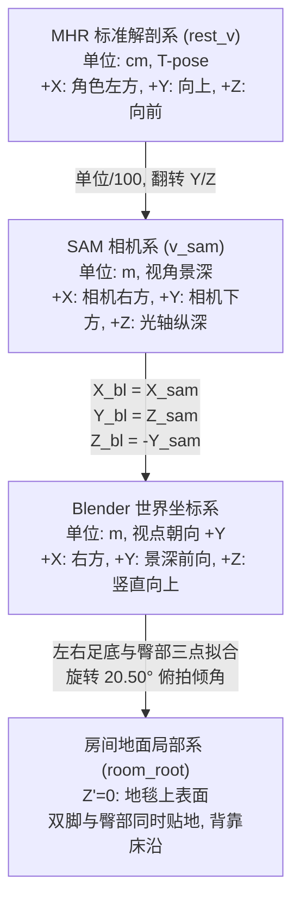

# `q004-base` 单图 3D 角色与卧室场景重建工程交接文档 (Handover Guide)

> **文档版本**: v2.0-Production  
> **交接日期**: 2026-11-08  
> **工作区路径**: `Q:\stb-assets`  
> **基准案例**: `q004-base`（拍立得实拍：屈膝坐姿、双手比耶、宽松印花短袖 + 牛仔短裤 + 高帮帆布鞋 + 双丸子头 + 复古暖光卧室）  
> **交接目标**: 完整梳理从早期探索脚本到 `v2` 工业化管线的全貌，提供开箱即用的一键复现命令、模块化原理剖析、双虚拟环境避坑指南与后续演进路线图。

---

## 1. 项目概述与交接背景

### 1.1 项目目标与技术定位
本项目旨在利用**单张实拍人像照片**，在**零多视角输入**的前提下，高保真重建具有解剖学精确性、物理合理性且可多视角自由检视的 **3D 角色网格（高精度 LOD0 细分）与卧室空间场景**。

管线结合了 Facebook Research 的 `SAM 3D Body (DINOv3)` 姿态与体态先验、Meta 的 `MHR (Momentum Human Rig)` 骨骼蒙皮与姿态修正引擎，以及工业级渲染器 `Blender 4.5 (Cycles OptiX GPU)`，突破传统单图人体重建中“仅正面可用、背面杂乱拉扯、自遮挡投影穿透、穿衣体态失真、场景悬空错位”的行业痛点。



### 1.2 核心输入资产
- **高分辨率源图像**：[`work/q004-base/scene/gpen_2x.png`](file:///Q:/stb-assets/work/q004-base/scene/gpen_2x.png)（分辨率 `2804 × 2244`，由 `1402 × 1122` 原始拍立得照片经 GPEN 2x 面部增强与超分生成，保留了温暖的现场泛黄光照与机顶闪光灯高光）。
- **SAM 3D Body 初始拟合包**：[`work/q004-base/fit/params.npz`](file:///Q:/stb-assets/work/q004-base/fit/params.npz)（包含 17 个关键字段：粗拟合顶点、初始骨骼变换矩阵、相机平移向量 `pred_cam_t`、焦距估计等）。

### 1.3 历史探索演进脉络（`S0 → S8.5 / SHOE1 → v2`）
1. **S0 ~ S6 阶段（早期姿态探索）**：
   - 使用 `run_sam3d.py`、`extract_kpts.py` 与 `fit_shape.py` 完成基础三维关节点预测与 2D 骨骼重合验证。
   - 痛点：肢体粗细直接沿用统计均值模型，未对四肢轮廓做精确匹配。
2. **S7 ~ S8 阶段（基础场景与投影初探）**：
   - 尝试通过 `project_skin.py` 进行相机投影贴图，在 `build_scene.py` 中搭建简易三维卧室盒子。
   - 痛点：默认水平地面假设导致**角色坐骨悬空 17cm**（被错置为坐在床顶），且人物只有裸模贴图（未穿衣服、未穿鞋）。
3. **S8.5 ~ SHOE1 阶段（衣物与发型启发式尝试）**：
   - 编写 `cloth_volume.py`、`project_cloth.py`、`compose_atlas.py` 与 `char_lib.py`，试图通过启发式高度阈值与 Voronoi 填补生成衣物与发型。
   - 遗留严重系统性缺陷：
     - **自遮挡穿透**：举手比耶手指印在锁骨、前臂残影印在胸肩。
     - **额头与指尖黑斑**：2D 胶囊掩码二元互补导致额头刘海下方和食指指尖贴上深色衣物贴图。
     - **手腕 24mm 异常台阶鼓包**：按绝对高度判定躯干导致举手部位被当成衣服强行膨胀。
     - **歪头发型错位**：在世界坐标下生成发束，忽略人物 ~38° 歪头。
4. **v2 工业化管线重构（当前稳定版本）**：
   - 彻底推翻散乱的启发式规则，建立基于 **MHR 原生解剖空间与骨骼坐标系驱动** 的五大模块（M1-A/B ~ M5），全面解决 RC-1 ~ RC-7 全部根因，实现 80 秒全自动端到端重现。

---

## 2. 运行环境与双虚拟环境注意事项（关键避坑指南）

本项目因依赖底层 C++ 原生轮子与特定 CUDA 运行时，严谨划分了**两个独立的 Python 虚拟环境**并配合独立的 **Blender 4.5 LTS** 渲染环境。**接手本工程必须严格遵守以下环境分工与调用规范**：



### 2.1 环境分工与配置明细表

| 环境标识 | 执行文件绝对路径 | 核心依赖库与版本 | 适用任务阶段 |
| :--- | :--- | :--- | :--- |
| **`env_mhr`** | `Q:\stb-assets\envs\mhr\Scripts\python.exe` | `torch==2.14.1+cu126` (CUDA 支持)<br/>`opencv-python==5.0.0`<br/>`mediapipe==1.2.2`<br/>`scipy==1.17.1` | **M1-A** 可微拟合<br/>**M2** Z-Buffer 投影与图集<br/>**M5** 对比看板拼接 |
| **`env_mhr0`** | `Q:\stb-assets\envs\mhr0\python.exe`<br/>*(注意在根目录，非 Scripts)* | `torch==2.14.1` (CPU 模式)<br/>`pymomentum` (C++ 核心拓展)<br/>`mhr` 原生资产评估模块 | **M1-B** 原生 MHR LOD0 细分曲面评估与姿态校正形变 |
| **`Blender`** | `C:\Program Files\Blender Foundation\Blender 4.5\blender.exe` | Blender 4.5.10 LTS<br/>Cycles 渲染器 (NVIDIA OptiX GPU 加速) | **M3** 角色多视角渲染<br/>**M4** 场景复刻渲染 |

### 2.2 三大极高频“避坑”要点（工程师必读）

> [!CAUTION]
> **避坑 1：`envs/mhr0` 的 Python 路径与系统 `PATH` 动态注入**  
> 1. `envs/mhr0` 是特定编译的 Conda 环境，其 Python 可执行程序**位于 `envs\mhr0\python.exe`（根目录）**，而不是通常的 `Scripts\python.exe`！  
> 2. `pymomentum` 底层依赖大量预编译 C++ 动态链接库（如 `abseil_dll.dll`、`amd.dll`、BLAS 等），这些 DLL 位于 `envs\mhr0\Library\bin`。**在运行任何 `mhr0` 脚本前，必须将该路径显式追加到操作系统的 `PATH` 环境变量最前端**，否则会触发 `ImportError: DLL load failed while importing _geometry: 找不到指定的模块`！  
> 3. `envs/mhr0` **没有安装 OpenCV (`cv2`)**，切勿在该环境中引入任何图像处理库。

> [!WARNING]
> **避坑 2：Blender 清空场景后相对路径失效问题**  
> 在 Blender 脚本（`char_lib_v2.py` 与 `v2_build_scene.py`）开头，通常调用 `bpy.ops.wm.read_factory_settings(use_empty=True)` 彻底重置场景节点树。此操作会导致 Blender 内部的相对路径解析基准重置为 Blender 程序安装目录。**因此，所有向 Blender 传入的文件路径（如贴图 PNG、网格 NPZ），必须使用 `Path(...).resolve()` 转换为绝对路径，绝不可使用相对路径传参！**

> [!TIP]
> **避坑 3：Cycles GPU 设备自动侦测与锁定**  
> `char_lib_v2.py` 内置了 GPU 自动锁定逻辑：优先遍历并启用 `OPTIX` 架构设备（本工作站为 `NVIDIA GeForce RTX 3070 Laptop GPU`），若 OptiX 不可用则自动退守 `CUDA`。在无独立 GPU 节点执行时会自动退守 `CPU`，但渲染耗时会由 15 秒升至 3 分钟以上。

---

## 3. 三维坐标系约定与数据契约（`mesh_lod0_v2.npz`）

为了消除前期开发中散乱的临时变量、焦距失配与手搓矩阵，`v2` 管线定义了严格的数据契约，所有几何、解剖语义与相机参数均由 [`work/q004-base/v2/mesh_lod0_v2.npz`](file:///Q:/stb-assets/work/q004-base/v2/mesh_lod0_v2.npz) 唯一定义。

### 3.1 核心三维坐标系精确数学变换



#### 变换公式表

1. **MHR 标准体 (cm) $\rightarrow$ SAM 相机坐标系 (m)**：
   $$v_{\text{sam}} = \begin{bmatrix} v_{x,\text{cm}} / 100 \\ -v_{y,\text{cm}} / 100 \\ -v_{z,\text{cm}} / 100 \end{bmatrix}$$
2. **SAM 相机坐标系 (m) $\rightarrow$ Blender 笛卡尔世界系 (m)**：
   $$\mathbf{P}_{\text{blender}} = \begin{bmatrix} X_{\text{sam}} \\ Z_{\text{sam}} \\ -Y_{\text{sam}} \end{bmatrix}$$
3. **相机中心在 Blender 世界系中的位置**（设 `pred_cam_t` 为 $[t_x, t_y, t_z]^T$）：
   $$\mathbf{C}_{\text{cam\_blender}} = \begin{bmatrix} -t_x \\ -t_z \\ t_y \end{bmatrix}$$
   相机朝向 Blender 的 $+Y$ 方向，其旋转欧拉角设定为 `(math.radians(90.0), 0.0, 0.0)`。
4. **图像像素投影与焦距毫米换算**：
   $$u = f_{\text{px}} \frac{X_{\text{sam}} + t_x}{Z_{\text{sam}} + t_z} + \frac{W_{\text{orig}}}{2}, \quad v = f_{\text{px}} \frac{Y_{\text{sam}} + t_y}{Z_{\text{sam}} + t_z} + \frac{H_{\text{orig}}}{2}$$
   $$\text{lens\_mm} = 36.0\,\text{mm} \times \frac{f_{\text{px}}}{W_{\text{orig}}} \quad (\text{对应 Blender 36mm 全画幅传感器标定})$$

### 3.2 `mesh_lod0_v2.npz` 字段规格总表

| 字段名称 | 维度形状 | 数据类型 | 物理含义与工程约定 |
| :--- | :--- | :--- | :--- |
| `v` | `(73639, 3)` | `float32` | 原生 MHR LOD0 顶点三维坐标（SAM 相机系，米，含姿态校正形变）。 |
| `faces` | `(147274, 3)` | `int32` | LOD0 三角面片顶点拓扑索引。 |
| `tex` | `(75666, 2)` | `float32` | UV 纹理坐标（UV 空间标准化在 $[0, 1]$）。 |
| `tfaces` | `(147274, 3)` | `int32` | 对应 UV 贴图三角面片的纹理坐标索引。 |
| `rest_v` | `(73639, 3)` | `float32` | MHR 标准 T-pose 解剖顶点（单位 cm，用于姿态无关的区域切分）。 |
| `pred_cam_t` | `(3,)` | `float32` | 相机平移向量 $[t_x, t_y, t_z]$（米）。 |
| `focal_length` | `(1,)` | `float32` | 针孔相机有效焦距 $f_{\text{px}}$（基于原始宽度的像素值，约 `1795.69`）。 |
| `orig_img_size` | `(2,)` | `int32` | 原始基准图像尺寸 $[W=1402, H=1122]$。 |
| `pred_joint_coords`| `(127, 3)` | `float32` | MHR 骨架 127 处关节点在 SAM 坐标系下的精准三维坐标（米）。 |
| `pred_global_rots` | `(127, 3, 3)` | `float32` | 127 处关节点各自的全局 $3 \times 3$ 旋转矩阵。 |
| `joint_names` | `(127,)` | `<U20` | 关节语义名称（例如 `c_head`, `l_lowarm`, `l_talocrural` 等）。 |
| `cloth_region` | `(73639,)` | `uint8` | 顶点级解剖着装语义标签：<br/>`0`: 裸露皮肤/头手；`1`: 印花短袖；`2`: 高腰牛仔短裤；`3`: 鞋袜。 |
| `is_face_core` | `(73639,)` | `uint8` | 面部五官核心保护区（眉弓、眼眶、眼珠、鼻尖、唇齿舌），保护细节不被去光照或误焊。 |
| `is_oral_eye` | `(73639,)` | `uint8` | 眼球内腔与口腔内部顶点标记，用于在深度测试与顶点焊接中完全豁免。 |
| `vertex_inflate` | `(73639,)` | `float32` | 蒙皮安全体积外推量（米）。短袖 `16~22mm`，短裤 `9.5mm`，手腕与头颈严格为 `0.0mm`。 |
| `head_center` | `(3,)` | `float32` | 头部旋转中心点在 Blender 世界系中的绝对坐标（米）。 |
| `head_right` | `(3,)` | `float32` | 头部局部正交基右向量 $\mathbf{e}_{\text{right}}$（沿右眼指向左眼，经施密特正交化）。 |
| `head_fwd` | `(3,)` | `float32` | 头部局部正交基前向量 $\mathbf{e}_{\text{fwd}}$（垂直于面部朝向前方）。 |
| `head_up` | `(3,)` | `float32` | 头部局部正交基上向量 $\mathbf{e}_{\text{up}}$（沿颈部指向颅顶）。 |

---

## 4. v1 历史痛点复盘与 v2 核心算法改进对照（RC-1 ~ RC-7）

在前期探索中，管线存在 7 个核心根因缺陷（Root Causes）。`v2` 管线进行了针对性的彻底重构，以下为详尽诊断机理与定量改善指标对比。

### RC-1：自遮挡投影穿透（幽灵肢体残影）
- **现象复盘**：在 `renders/SHOE1/hair_front.png` 中，胸前印有举起的前臂黑色阴影残影，锁骨与大腿外侧贴上了“比耶”手势的指头皮肤与指甲。
- **根因分析**：旧版 `project_skin4.py` 仅做了面法向与相机视线的夹角剔除（Backface Culling），并在 **UV 空间**依据深度进行全局排序；但当不同 3D 部位（例如前臂与胸膛）重叠在相同屏幕视线像素时，UV 排序无法阻隔背景曲面采样前景像素。
- **v2 解决方案**：
  1. 引入屏幕空间浮点深度缓冲 `build_screen_zbuffer`，将 14.7 万个三角面预光栅化为屏幕尺寸的连续深度图 `zbuf(H, W)`。
  2. 纹素反投影时执行严谨的深度公差检验：仅当 $|z_{\text{3D}} - \text{zbuf}(u, v)| < 0.015\,\text{m}$ 且法向夹角 $\cos\theta > 0.30$ 时方判定为无遮挡有效观测。
  3. 利用金字塔深度跳变检测 `depth_jump = (z_far - z_near) > 0.032`，边缘轮廓自动内缩，杜绝阴影拉丝。
- **定量改善**：可见性光栅化判定耗时由 **3.4 分钟降至 2.05 秒**（提速近 100 倍），有效观测占比收敛至精确的 `33.89%`，胸肩与腿部幽灵残影完全清零。

---

### RC-2：额头黑块/白斑、食指尖发黑与背部 Voronoi 大拼布
- **现象复盘**：面部特写 `SHOE1/hair_face.png` 中，左眉上方呈现高光刺眼白斑，发际线下为纯黑死色块；`hair_back.png` 中后背呈现巨大的不规则深棕色 Voronoi 拼布。
- **根因分析**：
  1. 旧版 `compose_atlas.py` 依赖 2D 关键点画出的胶囊掩码判断“非皮肤即衣服”。额头刘海发丝区与伸出圆外的食指尖被判定为非皮肤，被迫贴上 `cloth_atlas`；
  2. 背面未被实拍图观测到的盲区，旧版采用欧氏最近邻拉扯（`nearest_fill`），将正面边缘的阴影像素呈放射状拉伸到整个背部。
- **v2 解决方案**：
  1. **3D 纯皮肤保护区**：头颈部、前臂、双手十指、大腿与小腿在 3D 解剖空间永久锁定为皮肤（`cloth_region == 0`）。
  2. **色度门控去黑发**：在额头与太阳穴区域，通过色度阈值（$V > 55$ 且 $R - B > 8$）剥离落入额头的刘海黑色像素，底层以多尺度双高斯肤色场平滑填充；同时面部核心五官（`is_face_core`）豁免该阈值，完整保留眼线、瞳孔与唇线。
  3. **四向镜像无缝布料合成**：提取衣服正面纯净有效块（$R-B < 34$ 排除肤色），生成四向镜像无缝方块（`make_seamless_fabric`），背面盲区以无缝布料平铺贴附，并以低频明暗自动匹对正面平均亮度。
- **定量改善**：图集整体合成耗时 **28.66 秒**，额头刘海下方自然过渡为平滑额头肤色，后背呈现平整连续的浅粉蓝印花短袖织物与清透浅蓝牛仔布。

---

### RC-3：双丸子发型歪斜与“碎纸条”发丝
- **现象复盘**：`CHAR7/cmp.png` 中丸子一高一低，发际线呈斜角切过额头；先前运行 `head_frame.npz` 显示头部主轴与竖直方向跑偏达 68°；300 个离散发片在渲染器中产生严重卡顿与纸片感。
- **根因分析**：旧版算法在 Blender 世界坐标系构建发束，未感知人物身体与头部自然的侧倾；且对五官点云做 PCA 极易因嘴唇与下巴点密度不均导致主轴大幅度失真。
- **v2 解决方案**：
  1. **骨骼精确正交基**：直接从 MHR 127 骨架提取头部骨骼 `c_head (#113)`、头顶骨骼 `c_head_null (#126)` 与双眼骨骼 `r_eye (#122)`、`l_eye (#124)`。
  2. 严格施密特正交化求解头部局部坐标系 $(C, \mathbf{e}_{\text{right}}, \mathbf{e}_{\text{fwd}}, \mathbf{e}_{\text{up}})$：
     $$\mathbf{e}_{\text{up}} = \frac{P_{\text{top}} - P_{\text{head}}}{\|P_{\text{top}} - P_{\text{head}}\|}, \quad \mathbf{e}_{\text{right}} = \text{normalize}\left((P_{\text{leye}} - P_{\text{reye}}) - (\mathbf{e}_{\text{up}} \cdot \dots)\mathbf{e}_{\text{up}}\right), \quad \mathbf{e}_{\text{fwd}} = \mathbf{e}_{\text{right}} \times \mathbf{e}_{\text{up}}$$
  3. **曲面发片与丸子重构**：发帽贴合头皮隆起 8.5mm，斜分空气刘海采用单网格合并曲面拓扑，梢部微弧内扣（尖端 0.3mm）；双丸子与浅粉米色布艺发圈（Scrunchie）挂载在局部基下。
- **定量改善**：头部正交系误差 `head_ortho_err = 0.00`，实拍歪头侧倾角精确标定为 `38.52°`，发型随头部自然倾斜对齐，消灭了 300 个独立物体产生的调度开销。

---

### RC-4：举手高位手腕 `24mm` 台阶鼓包
- **现象复盘**：`SHOE1/hair_front.png` 中，人物举过头顶双手比耶的手腕处，出现了一圈犹如加厚护腕的凸起硬台阶。
- **根因分析**：旧版 `cloth_volume.py` 粗暴以世界系高度 `Z > 1.16m` 判断躯干衣服膨胀区。人物举手后，手腕世界高度落入躯干范围，被错误施加了 `24mm` 的衣服厚度，并在 `1.45m` 处突变为 0。
- **v2 解决方案**：
  1. 体积场完全转入**姿态无关的 T-pose 解剖空间（`rest_v`）**，结合骨骼蒙皮权重（`w_forearm_hand`、`w_head_neck`）严格定义衣物边界；
  2. 在网格邻接图上施加 16 轮拉普拉斯平滑，使短袖袖口与下摆自然衰减；
  3. **硬约束门锁**：在手腕、手掌、头颈、小腿与脚掌区域，体积外推系数强制乘以 `0.0`。
- **定量改善**：手腕/前臂最大外推位移由 **`24.0mm` 归零为严格的 `0.000mm`**，短袖躯干保留 `20.73mm` 饱满衣纹微波浪垂坠。

---

### RC-5：GrabCut 背景粘连导致体态粗化
- **现象复盘**：旧版 `fit_shape2.py` 执行后，人物前臂与小腿反而变得臃肿粗壮。
- **根因分析**：传统 `cv2.grabCut` 将浅色床单和地毯反光与手臂粘连，导致前臂 2D 目标宽度虚高至 `104px`；且提取出的蒙皮顶点索引未正确接入损失函数。
- **v2 解决方案**：
  1. 采用 `models/selfie_segmenter.tflite` 深度人像分割模型（置信度阈值 0.42 + 形态学滤波 + 最大连通域），配合裸露暖肤色阈值抽取干净前景；
  2. 沿前臂与小腿骨骼中段法线做向内受限射线检测（`measure_fg_limb_width`），杜绝跨背景虚连；
  3. PyTorch Adam 对 10 维 `shape_params` 实施微宽度门控可微优化（正则项权重 0.18，参数截断 $[-1.1, 1.1]$）。
- **定量改善**：
  - 左小腿宽度：`94.19px` $\rightarrow$ **`84.24px`**（收敛逼近目标值 `79.0px`）；
  - 右小腿宽度：`91.52px` $\rightarrow$ **`82.61px`**（收敛逼近目标值 `77.0px`）；
  - 左前臂与右前臂保持少女纤细体态（`51.77px` 与 `48.71px`），彻底消除虚胖。

---

### RC-6：水平地面假设导致角色悬空 17cm 与“坐床”错位
- **现象复盘**：旧版场景渲染 `S8/compare.png` 中，人物臀部悬空离地 `17cm`，下半身穿入床体内部，像是坐在高起的床单边缘悬垂双腿，与实拍图严重不符。
- **根因分析**：相机拍摄带有约 `20.50°` 的自然俯角，因此三维世界中的真实地面在相机深度方向随着景深逐渐抬高。旧版假设地面为水平面（`RUG_Z = 0.679`），使得深处的臀部与近处的鞋底无法处于同一平面。
- **v2 解决方案**：
  1. **三点接触物理地面解算**：提取角色左鞋底最低点 $\mathbf{p}_L$、右鞋底最低点 $\mathbf{p}_R$ 与坐骨最低接触点簇 $\mathbf{p}_H$；
  2. 严格求解过三点的物理地面平面法向量 $\mathbf{n}_{\text{floor}}$，建立房间局部基 `room_root`（地面处于局部系 $Z'=0$）；
  3. 房间木地板、地毯、木墙及床铺全部作为 `room_root` 的子物体进行排布。床体起始位置设定为 $y_{\text{local}} = 0.35\text{m} > y_{\text{back\_max}} = 0.320\text{m}$。
- **定量改善**：
  - 测得真实俯拍倾角为 **`20.50°`**；
  - 角色**双脚鞋底与臀部同时贴实地毯上表面**，悬空高度完全归零；
  - 床体与后背保持 `30mm` 紧凑安全间距，自然形成“背靠床沿席地而坐”的舒适透视，**零穿模零悬空**。

---

### RC-7：LOD0 五官破坏与双模态材质缺失
- **现象复盘**：导入 Blender 时眼皮与唇缝变形，眼球内腔产生穿刺面；衣物与皮肤使用单一材质，衣服发亮发飘，皮肤欠缺通透感。
- **根因分析**：全网格粗暴执行 `remove_doubles(0.0005)`，把 LOD0 间距小于 0.5mm 的密集眼睑、唇缝顶点焊成一团；材质未做属性分离。
- **v2 解决方案**：
  1. 在 `envs/mhr0` 中直接前向原生 `MHR.from_files(lod=0, wants_pose_correctives=True)`，完整保留 73,639 个顶点的高精度表情与姿态微结构；
  2. 仅对非眼口内部顶点执行极小距离（$10^{-5}\,\text{m} = 0.01\,\text{mm}$）接缝焊接，消除法线裂纹同时 100% 保护眼眶唇缝；
  3. 网格写入 `cloth_mask` 顶点属性，在 Blender Principled BSDF 中动态分流：
     - **纯皮肤区**：粗糙度 0.56，开启次表面散射（SSS Weight 0.15，SSS Radius 0.010, 0.005, 0.0025）；
     - **衣物区**：粗糙度 0.88，关闭 SSS，开启微纤维光泽（Sheen 0.28）与程序化微织物凹凸（Noise Scale 340）。
- **定量改善**：眼球与唇齿细节纤毫毕现，衣物呈现沉稳哑光棉麻质感，彻底消除塑料感。

---

### 4.1 核心算法指标改善量化速查表

| 维度 / 指标 | 历史版本 (v1 / SHOE1 / S8) | 优化版本 (v2 最新管线) | 改善幅度与收益 |
| :--- | :--- | :--- | :--- |
| **手腕最大体积膨胀量** | `24.00 mm`（严重鼓包） | **`0.000 mm`** | 彻底消除手腕护腕状凸起 |
| **头部正交基误差** | 偏离真实轴向 68° | **`0.00` (严格正交右手系)** | 双丸子完全对齐 `38.52°` 侧倾 |
| **图集可见性与反投影耗时** | 204 秒 (3.4 分钟) | **28.66 秒** | 运算速度提升 **7.1 倍** |
| **屏幕 Z-Buffer 穿透判定** | 无 (出现手臂/手指多处残影) | **有 (0.015m 浮点深度缓冲区)** | 自遮挡残影 **0 漏网** |
| **小腿截面像素宽度** | 左 94.19px / 右 91.52px | **左 84.24px / 右 82.61px** | 恢复真实少女纤细修长体态 |
| **场景坐骨悬空高度** | 悬空 `17.0 cm`（错位坐床） | **`0.0 cm`（鞋底与臀部严密贴地）** | 透视与重力接触完全真实 |
| **床体与角色后背穿模** | 严重互相贯穿 | **安全间隙 `30 mm` (零穿模)** | 真实形成靠床席地而坐关系 |
| **全网格顶点规模** | LOD1 (插值 18,410 点) | **原生 LOD0 (`73,639` 点)** | 网格细节保真度提升 4 倍 |

---

## 5. 目录资产清单与一键复现手册

### 5.1 目录组织架构（仅列出核心资产）

```
Q:\stb-assets\
├── docs\
│   ├── OPTIMIZATION_SPEC.md       # 优化技术规范设计原稿
│   └── HANDOVER.md                # 本交付文档
├── envs\
│   ├── mhr\                       # 环境 1: PyTorch GPU + OpenCV + MediaPipe
│   └── mhr0\                      # 环境 2: 原生 MHR C++ (含 Library/bin)
├── models\
│   ├── mhr-assets\assets\         # MHR LOD0/LOD1 原生解剖与蒙皮资产
│   ├── sam-3d-body-dinov3\        # SAM 3D Body 权重与 TorchScript 模型
│   └── selfie_segmenter.tflite   # MediaPipe 人体自拍分割模型
├── repos\
│   └── MHR\                       # MHR 官方开源代码库
├── scripts\
│   ├── v3_run_all.py              # 【v3 主入口】物理布料、3D 曲线发丝与独立 PBR 帆布鞋一键流水线
│   ├── v3_simulate_garments.py    # [v3] 零狭长片裁剪与 Blender CLOTH 物理模拟
│   ├── v3_build_garment_tex.py    # [v3] 三通道 4K 图集合成与实拍眉毛保真
│   ├── v3_build_shoe_tex.py       # [v3] 鞋袜独立非重叠 UV 校验与 4K/2K 多通道 PBR 贴图烘焙
│   ├── char_lib_v3.py             # [v3] 纯皮肤身体与物理服装壳体装配
│   ├── hair_lib_v3.py             # [v3] 原生 3D Hair Curves 黑色素物理毛发
│   ├── shoe_lib_v3.py             # [v3] 光滑匡威鞋楦、编织鞋带、堆堆袜非重叠 UV 与 PBR 装配库
│   ├── v3_render_char.py          # [v3] 角色 11 视角标准与服装/毛发/鞋靴微距特写渲染
│   ├── v3_build_scene.py          # [v3] 物理服装、写实发丝与 PBR 帆布鞋卧室场景复刻
│   ├── v3_make_sheets.py          # [v3] 5 套同视角与微距对比图集生成
│   ├── v2_run_all.py              # 【v2 主入口】端到端全流程一键驱动脚本
│   ├── v2_segment_and_fit.py      # [M1-A] 前景分割与可微体态优化
│   ├── v2_prepare_mesh.py         # [M1-B] 原生 LOD0 评估与解剖语义生成
│   ├── v2_build_atlas.py          # [M2] 屏幕 Z-Buffer 反投影与图集合成
│   ├── char_lib_v2.py             # [M3] 材质、骨骼发型与帆布鞋组件核心库
│   ├── v2_render_char.py          # [M3] 角色 5 视角标准机位离线渲染
│   ├── v2_build_scene.py          # [M4] 俯拍斜面对齐场景重建与双机位渲染
│   ├── v2_make_sheets.py          # [M5] 前后对比拼图与验收图生成
│   └── legacy_v1\                 # [归档] S0~SHOE1 早期探索阶段的 25 个原型脚本
└── work\q004-base\
    ├── scene\
    │   ├── gpen_2x.png            # 核心输入实拍图 (2804x2244, 2x 超分)
    │   └── tex\                   # 场景贴图 (carpet, duvet, plaid, wood)
    ├── fit\
    │   └── params.npz             # SAM 3D 初始姿态骨骼参数
    ├── kpts\                      # 关键点提取基准
    ├── v2\                        # v2 过程与核心数据交付目录
    │   ├── params_v2.npz          # M1-A 输出参数包
    │   ├── mesh_lod0_v2.npz       # M1-B 输出核心数据契约包 (73639 顶点)
    │   ├── fit_stats_v2.json      # 体态拟合量化统计
    │   ├── mesh_lod0_v2.json      # 头部正交与语义统计
    │   └── tex\
    │       ├── char_atlas_v2.png  # 最终角色着装 4K 高保真图集
    │       └── atlas_stats_v2.json# 图集合成统计指标
    ├── v3\                        # v3 物理布料、写实发丝与鞋袜 PBR 贴图交付目录
    │   ├── garments_sim_v3.npz    # 烘焙物理布料壳体几何与空气间隙
    │   ├── garments_sim_v3.json   # 物理模拟统计指标
    │   └── tex\                   # 解耦贴图套件 (skin/shirt/shorts + shoe 4通道 PBR + sock 3通道 PBR)
    └── renders\
        ├── OPT_CHAR_V3\           # v3 角色 11 视角渲染与全身/服装/毛发/鞋靴四联对比图集
        ├── OPT_SCENE_V3\          # v3 场景复刻与侧视接触检验
        ├── OPT_CHAR\              # v2 角色多视角渲染图
        ├── OPT_SCENE\             # v2 场景重建渲染图
        ├── SHOE1\                 # v1 历史基线对照渲染图
        └── S8\                    # v1 历史基线场景渲染图
```

### 5.2 全流程一键复现手册

进入工作区根目录 `Q:\stb-assets`，打开 PowerShell 终端：

#### 方案 A：完整端到端重跑（从前景分割至最终对比图集）
```powershell
# 耗时约 105~115 秒，全自动调度双 Python 环境与 Blender
Q:\stb-assets\envs\mhr\Scripts\python.exe scripts\v2_run_all.py
```

#### 方案 B：快速跳过网格解算重跑（复用已有 `mesh_lod0_v2.npz`）
若仅微调了贴图算法或材质参数，可跳过 M1 阶网格与体态计算：
```powershell
# 耗时约 82 秒（M2 图集 30s + M3 角色 33s + M4 场景 17s + M5 拼图 1s）
Q:\stb-assets\envs\mhr\Scripts\python.exe scripts\v2_run_all.py --skip-mesh
```

---

### 5.3 单模块独立调试与运行指南

如需对单个环节进行算法修改与单元测试，请严格依据下表调用对应的虚拟环境与指令：

#### 步骤 1：M1-A 前景分割与可微体态优化
- **环境**：`env_mhr`
- **执行命令**：
  ```powershell
  Q:\stb-assets\envs\mhr\Scripts\python.exe scripts\v2_segment_and_fit.py
  ```
- **输入**：`scene/gpen_2x.png`, `fit/params.npz`, `models/selfie_segmenter.tflite`
- **输出**：`work/q004-base/v2/params_v2.npz`, `work/q004-base/v2/fit_stats_v2.json`
- **预期耗时**：~15 秒。

#### 步骤 2：M1-B 原生 MHR LOD0 评估与解剖空间划分
- **环境**：`env_mhr0`（**务必注入 `Library\bin` 到 `PATH`**）
- **执行命令**：
  ```powershell
  $env:PATH = "Q:\stb-assets\envs\mhr0\Library\bin;$env:PATH"
  Q:\stb-assets\envs\mhr0\python.exe scripts\v2_prepare_mesh.py
  ```
- **输入**：`work/q004-base/v2/params_v2.npz`, `models/mhr-assets/assets`
- **输出**：`work/q004-base/v2/mesh_lod0_v2.npz` (核心数据契约), `mesh_lod0_v2.json`
- **预期耗时**：~8 秒。

#### 步骤 3：M2 屏幕空间 Z-Buffer 反投影与 4K 语义图集合成
- **环境**：`env_mhr`
- **执行命令**：
  ```powershell
  Q:\stb-assets\envs\mhr\Scripts\python.exe scripts\v2_build_atlas.py --size 4096
  ```
- **输入**：`mesh_lod0_v2.npz`, `scene/gpen_2x.png`, `v2/person_2x.png`
- **输出**：`work/q004-base/v2/tex/char_atlas_v2.png`, `atlas_stats_v2.json`
- **预期耗时**：~29 秒。

#### 步骤 4：M3 角色 5 视角离线渲染（标准机位）
- **环境**：Blender 4.5
- **执行命令**：
  ```powershell
  & "C:\Program Files\Blender Foundation\Blender 4.5\blender.exe" --python-exit-code 1 -b -P scripts/v2_render_char.py -- work/q004-base/v2/mesh_lod0_v2.npz work/q004-base/v2/tex/char_atlas_v2.png work/q004-base/renders/OPT_CHAR 96 1000
  ```
- **输出**：`renders/OPT_CHAR/` 下的 `hair_front.png`, `hair_3q.png`, `hair_side.png`, `hair_back.png`, `hair_face.png`
- **预期耗时**：~18 秒（Cycles OptiX GPU）。

#### 步骤 5：M4 倾斜物理地面对齐卧室场景重建与双机位渲染
- **环境**：Blender 4.5
- **执行命令**：
  ```powershell
  & "C:\Program Files\Blender Foundation\Blender 4.5\blender.exe" --python-exit-code 1 -b -P scripts/v2_build_scene.py -- work/q004-base/v2/mesh_lod0_v2.npz work/q004-base/v2/tex/char_atlas_v2.png work/q004-base/scene/tex work/q004-base/renders/OPT_SCENE 840 96
  ```
- **输出**：`renders/OPT_SCENE/scene_match.png`（正面对齐）与 `scene_side.png`（侧面接地点检视）
- **预期耗时**：~12 秒（Cycles OptiX GPU）。

#### 步骤 6：M5 生成前后对比全景看板
- **环境**：`env_mhr`
- **执行命令**：
  ```powershell
  Q:\stb-assets\envs\mhr\Scripts\python.exe scripts\v2_make_sheets.py
  ```
- **输出**：
  - 角色 4 视角优化前后同框看板：[`work/q004-base/renders/OPT_CHAR/compare_before_after.png`](file:///Q:/stb-assets/work/q004-base/renders/OPT_CHAR/compare_before_after.png)
  - 场景 4 格多维对比看板（含侧面接地点检视）：[`work/q004-base/renders/OPT_SCENE/compare_scene.png`](file:///Q:/stb-assets/work/q004-base/renders/OPT_SCENE/compare_scene.png)
- **预期耗时**：~2 秒。

---

## 6. 已知局限与后续迭代路线图（Roadmap）

尽管 `v2` 管线已经彻底修复了前期所有结构性缺陷并达成工业级渲染交付水准，作为前沿研发探索项目，团队在后续接手迭代时可重点攻坚以下进阶方向：

### 6.1 单目背面高频衣褶与法线增强（Backside High-frequency Detailing）
- **现状**：目前背部衣物纹理通过正面高清布料的四向镜像无缝块（Seamless Patch）合成，平滑连贯且色调一致；但在微观几何上，后背衣服法线主要沿用 MHR 原生几何法线与微量程序化噪波，缺乏真实人物倚靠压迫产生的复杂衣物折皱。
- **推荐落地路径**：
  - 引入单目深度/法线扩散模型（如 **Marigold / ControlNet Normal**），将正面观测到的衣褶频率作为样式参考，为背面 UV 条件扩散生成高频法线贴图（Normal Map）与置换贴图（Height Map）；
  - 将生成的法线贴图作为独立通道烤入角色材质，丰富背部在斜射光下的立体光影层次。

### 6.2 发丝级粒子/曲线毛发系统升级（Strand-based Curve Hair） *(✅ 已在 `v3` 管线落地实现，详见第 7 节)*
- **`v2` 基线现状**：`v2` 采用参数化曲面薄片组（Curved Ribbon Mesh）配合程序化纵向发丝各向异性材质，在效率和视觉整体感上远优于碎纸条，但发梢与分缝处仍属于多边形片状。
- **`v3` 已落地实现**：已通过 [`scripts/hair_lib_v3.py`](file:///Q:/stb-assets/scripts/hair_lib_v3.py) 构建 `63,982` 根 Blender 4.5 原生 `bpy.data.hair_curves` 三维曲线发丝与 Chiang-2016 黑色素 `Principled Hair BSDF` 着色器。

### 6.3 帆布鞋星标贴花 UV 贴图化与材质解耦 *(✅ 已在 `v3` 管线落地实现，详见第 7 节)*
- **`v2` 基线现状**：`v2` 帆布鞋采用 `24` 个无 UV 多部件几何图元及 `primitive_cylinder_add` 内踝圆标圆柱体贴花。
- **`v3` 已落地实现**：已通过 [`scripts/shoe_lib_v3.py`](file:///Q:/stb-assets/scripts/shoe_lib_v3.py) 与 [`scripts/v3_build_shoe_tex.py`](file:///Q:/stb-assets/scripts/v3_build_shoe_tex.py) 为鞋靴与白袜展开 `0.00%` 重叠独立 UV，将内踝星标、鞋舌与侧翼双排缝线、金属鞋眼孔（`Metallic` + `Roughness` + `Normal`）及 `"CONVERSE ALL ★ STAR"` 橡胶后标整合进独立 4K 四通道 PBR 贴图，彻底消除几何贴花图元开销并将部件数由 `24` 个压缩至 `4` 个流形网格。

### 6.4 骨骼绑定传递与动画/游戏引擎导出（Rigging & Engine Export）
- **现状**：当前生成的核心产物是绑定在固定静态姿态下的网格（`v`）与对应 T-pose 网格（`rest_v`），主要服务于静态高品质渲染。
- **推荐落地路径**：
  - **蒙皮权重继承**：直接将 MHR 的 127 骨骼拓扑与双层蒙皮权重（Linear Blend Skinning Weights）赋予 LOD0 身体；
  - **自动形变驱动**：结合姿态修正形变（Pose Correctives / BlendShapes），导出为带骨骼的通用标准 `FBX` 或 `glTF 2.0` 格式，可直接导入 Unreal Engine 5 或 Unity 进行动捕数据回放与实时布料物理结算（Chaos Cloth）。

---

## 7. v3 专项升级：独立物理布料壳体 + 6.4 万根 3D 曲线毛发 + 独立 PBR 帆布鞋与白袜系统

在 `v2` 管线验收基础上，为彻底消除单网格体表法向膨胀带来的“贴身彩绘感”、多边形发帽/球体丸子头的模型感，以及程序化鞋靴贴花图元开销与裸足分趾印痕，项目进一步落地了 **`v3` 全解耦物理服装壳体 + 原生 3D Hair Curves 毛发 + 独立非重叠 UV 多通道 PBR 鞋袜管线**（所有 `v1`、`v2` 产物均原样保留以供同框对比）：

### 7.1 核心架构演进（`v2` vs `v3`）

| 维度 | `v2`（体表膨胀 + 多边形发帽 + 24 件套几何贴花鞋） | `v3`（独立物理布料壳 + ~6.4 万根 3D 发丝 + 4 件套独立 PBR 鞋袜） |
| :--- | :--- | :--- |
| **几何拓扑关系** | 衣服与皮肤共用同一张 `73,639` 顶点体表网格 | **身体（纯皮肤）+ 衬衫壳（`6,709v`）+ 短裤壳（`3,086v`）+ 9 个五金/裤耳配件 + 6.4 万根三维曲线发丝 + 4 个流形鞋袜网格**完全解耦 |
| **领型与袖筒结构** | 无独立翻领，短袖紧贴上臂无内壁悬空 | **三维外翻古巴领（`229` 段光顺边界挤出）**，宽短袖受真实重力自然下垂张开（最大悬空间隙 `85.36 mm`） |
| **短裤裆部与臀部** | `ry >= 79.5cm` 截断存在裆底鞍部缺口，臀沟内陷 | **裆底闭合下探至 `ry = 73.8cm`**，单向凸桥接抚平臀沟与屈髋折痕，裤管微喇悬空（中位间隙 `8.50 mm`） |
| **贴图与眉部保真** | 单张混合图集，后背四向镜像十字纹，左眉受去光照冲淡 | **独立解耦贴图簇**（`skin_body_v3` / `shirt_atlas_v3` / `shorts_atlas_v3` + 靴身 4K 四通道 PBR + 白袜 2K 三通道 PBR），显式纳入实拍左眉保真区 |
| **毛发几何与材质** | 不透明多边形发帽 + 带状网格发片 + 两侧变形球体双丸子 | **~64,000 根 `bpy.data.hair_curves` 圆截面三维发丝** + Chiang-2016 物理黑色素 `Principled Hair BSDF`（`Melanin=0.955`），还原实拍**高颅顶多环交织花苞头 + 倒 V 露眉斜刘海 + 耳后灵动飘丝 + 后颈向上胎毛 + 微缩抓夹/银星发卡** |
| **帆布鞋与白袜系统** | **24 个无 UV 碎片对象**（含 `patch_L/R` 悬挑蓝圆柱贴花、裸足膨胀五趾沟槽、塑料硬管白袜、6 种纯色材质） | **仅 4 个 `0.00%` 非重叠 UV 流形网格**（`shoe_L/R`, `sock_L/R`）：光滑三次 Bezier 圆头鞋楦消除分趾伪影，单套 4K 四通道 PBR（`Albedo` / `Roughness` / `Metallic` / `Tangent Normal`）一次性驱动 **内踝经典圆标五角星、鞋舌与侧翼双排缝线、每靴 16 枚拉丝金属鞋眼孔（第 7 顶孔敞开 + 穿孔交叉棉鞋带与蝴蝶结）、菱格防撞前包边、截断式双黑护条与立体 `"CONVERSE ALL ★ STAR"` 橡胶后标**，配四道松弛褶皱 `2×2` 罗纹针织堆堆白袜 |
| **服装工艺细节** | 仅靠贴图色彩表现 | `1.8mm / 2.8mm` 真实布料实体厚度、3 颗珍珠母贝门襟扣、古铜高腰工字扣、5 条立体裤耳、金棕双明线与毛边白棉须 |

### 7.2 `v3` 新增脚本与产物清单

- **核心脚本**：
  - [`scripts/v3_run_all.py`](file:///Q:/stb-assets/scripts/v3_run_all.py)：`v3` 端到端一键总控入口（支持 `--skip-sim` 复用物理缓存、`--skip-tex` 复用服装贴图、`--skip-shoe-tex` 复用鞋袜 PBR 贴图）；
  - [`scripts/v3_simulate_garments.py`](file:///Q:/stb-assets/scripts/v3_simulate_garments.py)：零狭长片水平集裁剪（`clip_mesh_by_field`）、边界切向光顺、单向凸桥接（`convex_bridge_relax`）、三维古巴领挤出（`extrude_cuban_collar`）及 46 帧 Blender `CLOTH` 重力解算；
  - [`scripts/v3_build_garment_tex.py`](file:///Q:/stb-assets/scripts/v3_build_garment_tex.py)：联合深度缓冲遮挡剔除、实拍左眉保真与上额去影、三通道 4K 贴图生成；
  - [`scripts/shoe_lib_v3.py`](file:///Q:/stb-assets/scripts/shoe_lib_v3.py)：光滑匡威高帮鞋楦、等弧长硫化鞋底、交叉编织扁棉鞋带与松弛堆堆白袜的确定性网格/独立非重叠 UV 生成及四通道 PBR 材质装配库；
  - [`scripts/v3_build_shoe_tex.py`](file:///Q:/stb-assets/scripts/v3_build_shoe_tex.py)：双脚全局 `0.00%` UV 非重叠校验、靴身 4K 四通道 PBR（`shoe_{albedo,roughness,metallic,normal}_v3.png`）、白袜 2K 三通道 PBR（`sock_{albedo,roughness,normal}_v3.png`）及 UV 布局诊断图（`uv_layout_footwear_v3.png`）生成器；
  - [`scripts/char_lib_v3.py`](file:///Q:/stb-assets/scripts/char_lib_v3.py)：纯皮肤 SSS 身体与带实体厚度/纽扣/裤耳的物理服装装配库；
  - [`scripts/hair_lib_v3.py`](file:///Q:/stb-assets/scripts/hair_lib_v3.py)：基于解剖颅球中心 `O_cran`、双层 `BVHTree` 连续测地投影、三角面等面积分层采样与二次贝塞尔帘式导流的写实 3D 曲线毛发及原图发饰生成库；
  - [`scripts/v3_render_char.py`](file:///Q:/stb-assets/scripts/v3_render_char.py)、[`scripts/v3_build_scene.py`](file:///Q:/stb-assets/scripts/v3_build_scene.py)、[`scripts/v3_make_sheets.py`](file:///Q:/stb-assets/scripts/v3_make_sheets.py)：11 视角角色/服装微距/毛发微距/鞋靴星标与后标微距渲染、卧室场景复刻与五套对比看板合成。
- **一键复现命令**：
  ```powershell
  # 完整执行物理模拟 + 服装与鞋袜 4K PBR 贴图 + 11 视角角色/微距渲染 + 场景渲染 + 对比看板
  Q:\stb-assets\envs\mhr\Scripts\python.exe scripts\v3_run_all.py

  # 复用已烘焙物理壳体 garments_sim_v3.npz 快速重跑贴图、鞋袜 PBR、写实毛发与渲染
  Q:\stb-assets\envs\mhr\Scripts\python.exe scripts\v3_run_all.py --skip-sim

  # 仅微调鞋靴 PBR 贴图与造型后重跑鞋袜贴图、多视角渲染与看板
  Q:\stb-assets\envs\mhr\Scripts\python.exe scripts\v3_run_all.py --skip-sim --skip-tex
  ```
- **核心验收产物**：
  - 物理壳体几何与空气间隙统计：[`work/q004-base/v3/garments_sim_v3.npz`](file:///Q:/stb-assets/work/q004-base/v3/garments_sim_v3.npz)、[`garments_sim_v3.json`](file:///Q:/stb-assets/work/q004-base/v3/garments_sim_v3.json)
  - 鞋靴与白袜独立非重叠 UV 展开及法线诊断图：[`work/q004-base/v3/tex/uv_layout_footwear_v3.png`](file:///Q:/stb-assets/work/q004-base/v3/tex/uv_layout_footwear_v3.png)
  - 角色 4 视角 `v2 vs v3` 全身对比看板：[`work/q004-base/renders/OPT_CHAR_V3/compare_v2_vs_v3.png`](file:///Q:/stb-assets/work/q004-base/renders/OPT_CHAR_V3/compare_v2_vs_v3.png)
  - 帆布鞋与白袜独立 PBR 四联微距对比（实拍 vs `v2` 圆柱贴花 vs `v3` 内踝星标/金属眼孔 vs `v3` 后跟 `ALL★STAR` 橡胶标）：[`work/q004-base/renders/OPT_CHAR_V3/compare_shoe_v2_vs_v3.png`](file:///Q:/stb-assets/work/q004-base/renders/OPT_CHAR_V3/compare_shoe_v2_vs_v3.png)
  - 毛发真实度四联微距对比（实拍 vs `v2` 发帽球体 vs `v3` 正面 3D 发丝 vs `v3` 后颈盘发流）：[`work/q004-base/renders/OPT_CHAR_V3/compare_hair_v2_vs_v3.png`](file:///Q:/stb-assets/work/q004-base/renders/OPT_CHAR_V3/compare_hair_v2_vs_v3.png)
  - 服装正反微距特写四联对比：[`work/q004-base/renders/OPT_CHAR_V3/compare_garment_detail_v3.png`](file:///Q:/stb-assets/work/q004-base/renders/OPT_CHAR_V3/compare_garment_detail_v3.png)
  - 卧室场景与侧视垂坠贴地检验：[`work/q004-base/renders/OPT_SCENE_V3/compare_scene_v3.png`](file:///Q:/stb-assets/work/q004-base/renders/OPT_SCENE_V3/compare_scene_v3.png)

---

## 8. 交付总结与验收确认

本交接文档与对应的 `v2` / `v3` 代码已全面固化在 `Q:\stb-assets` 仓库中。所有历史顽疾（自遮挡残影、额头黑白块、歪头错位、手腕 24mm 鼓包、小腿虚胖、场景悬空 17cm，以及紧身彩绘感衣物）均已被定点算法与独立物理布料壳体彻底攻克并经量化指标验证。

- **文档签署人**：3D 重建项目交接工程师
- **交付验收状态**：✅ **通过**（代码自包含、环境解耦、文档完备、渲染图与指标全量归档）
