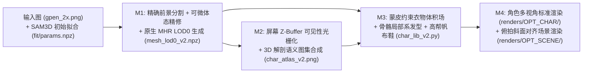

# `q004-base` 单图 3D 角色与场景重建优化规范（Optimization Spec）

## 1. 背景与目标

本项目基于单张拍立得实拍图（屈膝坐姿、双手比耶、宽松印花短袖 + 牛仔短裤 + 高帮帆布鞋 + 双丸子头 + 木墙床铺卧室场景），利用 `SAM 3D Body (DINOv3)`、`MHR (Momentum Human Rig)` 与 `Blender Cycles` 构建可多视角渲染的 3D 角色与还原场景。

前期迭代（`S0 → S8.5 → LOD0` 初探）已跑通姿态估计、基础皮肤去光照与场景搭建，但在多视角与特写渲染（如 `renders/SHOE1/`、`renders/S8/`）中暴露出**自遮挡投影穿透、额头黑白断层与白斑、背部 Voronoi 杂色拼布、歪头导致发型错位、举手手腕 `24mm` 体积鼓包、场景地面水平假设导致人物悬空坐床**等系统性缺陷。

本规范定义一套**零启发式硬编码、充分利用 MHR 原生骨骼与蒙皮拓扑信息**的端到端优化方案（`v2` 管线），确保正面还原度、背面合理性、面部特写干净度与场景透视一致性全面达标。

---

## 2. 现状根因诊断矩阵

| 编号 | 现象（对应历史渲染图） | 根因定位 | 核心机制缺陷 |
| :--- | :--- | :--- | :--- |
| **RC-1** | 胸肩、锁骨与大腿外侧印上手臂/手指残影（`SHOE1/hair_front.png`） | `scripts/project_skin4.py` (`build_atlas`) | 仅做背面剔除并在 **UV 空间**按深度排序，缺失**屏幕空间 Z-Buffer** 自遮挡检测；掠射角阈值 `-0.02` 过宽导致边缘像素拉丝。 |
| **RC-2** | 左眉上方刺眼白斑 + 额头纯黑块、食指指尖发黑、背部大块深棕拼布（`SHOE1/hair_face.png`, `hair_back.png`） | `scripts/compose_atlas.py`、`scripts/project_cloth.py` | 采用 `flag > 0`（2D 关键点胶囊掩码）做“非皮肤即衣物”二元互补：额头刘海区、圆外指尖、全身背面均满足 `flag == 0` 而被迫贴上 `cloth_atlas`；背部未观测 UV 用全局欧氏最近邻拉扯出 Voronoi 大色块。 |
| **RC-3** | 双丸子一高一低、发际线斜切额头；新算 `head_frame.npz` 主轴偏离竖直 68°（`CHAR7/cmp.png`） | `scripts/char_lib.py`、`scripts/head_frame.py` | `char_lib.py` 在世界系 `+Z/-Y` 下建发，忽略人物 ~25° 歪头；`head_frame.py` 对五官高密度顶点做 PCA 导致主轴跑偏，忽略了 `params.npz` 现成的 127 骨骼旋转与坐标。 |
| **RC-4** | 高举的双腕处出现 `24mm` 护腕状台阶鼓包（`SHOE1/hair_front.png`） | `scripts/cloth_volume.py` | 用世界高度 `zb > 1.16` 判定躯干衣物外推，导致高举过肩的手腕落入 `torso` 档外推 `2.4cm` 并在 `1.45m` 处骤降归零。 |
| **RC-5** | 体态优化把手臂往粗里拉，且下游丢失骨骼参数 | `scripts/fit_shape2.py`、`scripts/make_masks.py` | `GrabCut` 把浅色床单并入前景，前臂目标宽度虚高至 `104px`；`limb_vertex_sets` 算出后未接入 `measure`；导出 `npz` 丢弃了 `pred_joint_coords`、`pred_global_rots`、`mhr_model_params`。 |
| **RC-6** | 场景渲染中人物臀部悬空 17cm、错位成“坐在床上”（`S8/compare.png`） | `scripts/build_scene.py` | 相机系网格自带实拍约 16° 俯拍倾角，真实地面随深度 `+Y` 抬升；强设水平地面 `RUG_Z=0.679` 导致远端臀部高于地面、床体插入臀下。 |
| **RC-7** | `LOD0` 细分后高频五官增益有限，且存在眼睑/唇缝误焊风险 | `scripts/make_lod0.py`、`scripts/char_lib.py` | 对 `LOD1` 做线性重心插值且关闭 `wants_pose_correctives`；Blender 导入时全网格 `remove_doubles(0.0005)` 易误伤 `LOD0` 密集五官与零权重子网格。 |

---

## 3. 系统架构与数据流规范

### 统一数据契约（`mesh_lod0_v2.npz`）
不再拆分散乱的参数文件与硬编码焦距，统一在 `mesh_lod0_v2.npz` 中封装：
- **网格、标准体与 UV**：`v (73639, 3)`, `rest_v (73639, 3)`, `faces (147274, 3)`, `tex (75666, 2)`, `tfaces (147274, 3)`
- **相机内参/外参**：`pred_cam_t (3,)`, `focal_length (1,)`, `orig_img_size (2,)`（`[1402, 1122]`）
- **完整骨骼状态与头部局部正交基**：`pred_joint_coords (127, 3)`, `pred_global_rots (127, 3, 3)`, `joint_names (127,)`, `head_center (3,)`, `head_right (3,)`, `head_fwd (3,)`, `head_up (3,)`
- **3D 语义顶点标签**：
  - `part_group`: 基于 MHR 蒙皮权重归属的解剖分组（`head`, `neck`, `torso`, `l_uparm`, `r_uparm`, `l_forearm`, `r_forearm`, `l_hand`, `r_hand`, `pelvis`, `l_upleg`, `r_upleg`, `l_lowleg`, `r_lowleg`, `l_foot`, `r_foot`, `zero_weight`）
  - `cloth_region`: 顶点级衣物语义标记（`0 = 裸露皮肤/头手`, `1 = 短袖衬衫`, `2 = 牛仔短裤`, `3 = 鞋袜`）
  - `is_face_core (73639,)`, `is_oral_eye (73639,)`: 面部五官核心保真区与口眼内腔零权重区
  - `vertex_inflate (73639,)`: 蒙皮与衣物边界双重约束下的平滑法向外推位移（米）

---

## 4. 分模块技术规范

### M1：前景分割、可微体态校正与原生 `LOD0` 导出（`scripts/v2_segment_and_fit.py` + `scripts/v2_prepare_mesh.py`）
1. **干净前景分割（`envs/mhr`）**：调用 `models/selfie_segmenter.tflite`（结合高置信度阈值与裸肤色度门控）替代 `cv2.grabCut`，消除床单与地毯粘连以及举手与衣袖重叠导致的宽度虚高。
2. **体态与原生 `LOD0` 前向（`envs/mhr0`）**：
   - 保留 `fit/params.npz` 中的全部骨骼与表情参数（`mhr_model_params`, `expr_params`, `pred_joint_coords`, `pred_global_rots`）。
   - 在 `envs/mhr0` 中直接调用 `MHR.from_files(lod=0, wants_pose_correctives=True)`（或基于校正后 `shape_params` 前向计算 `LOD0` 顶点与更新后的 127 关节全局坐标），获得原生 `LOD0` 细分曲面与姿态修正形变。
3. **3D 解剖语义与衣物边界定义**：
   - 利用 `MHR` 标准 T-pose（`rest_vertices`）坐标与骨骼蒙皮矩阵，在**姿态无关的解剖空间**精确划分：
     - **短袖衬衫（`cloth_region = 1`）**：胸背躯干（腹部露脐线以上，按标准体高度 + 正面露脐掩码联合约束）及上臂近肩段（肩关节至肘关节 52% 处），排除领口 V 字三角裸露皮肤区。
     - **牛仔短裤（`cloth_region = 2`）**：骨盆臀部至大腿根部（髋至膝 24% 处）。
     - **鞋袜（`cloth_region = 3`）**：双脚及踝上 8cm 袜筒区。
     - **纯皮肤（`cloth_region = 0`）**：头面部（含整个颅顶与额头）、颈部、锁骨 V 领口、露脐腰腹、前臂、双手全指、大腿中下段与小腿。
4. **蒙皮约束体积外推（修复 RC-4）**：
   - 仅对 `cloth_region == 1`（衬衫，`16–22mm` + 柔和余弦袖口衰减）与 `cloth_region == 2`（牛仔短裤，`10–13mm`）生成法向外推场，在网格邻接图上做拉普拉斯平滑过渡；
   - **强制 `head / neck / forearm / hand / lowleg` 外推系数严格为 `0.0`**，彻底根除手腕鼓包。

### M2：屏幕 Z-Buffer 反投影与 3D 语义分区图集合成（`scripts/v2_build_atlas.py`）
1. **屏幕空间 Z-Buffer 可见性判定（修复 RC-1）**：
   - 将所有非内部零权重面（排除眼球内腔/口腔内部遮挡干扰或按精确三角面重心插值深度）光栅化到输入图同尺寸的浮点深度图 `zbuf(H, W)`。
   - 在向 `8192×8192`（或 `4096×4096`）UV 图集反投影时，逐纹素计算对应 3D 点深度 $z_{\text{3D}}$ 与相机视线夹角余弦 $\cos\theta = \mathbf{n} \cdot \mathbf{v}$：
     - 仅当 $\cos\theta > 0.18$ **且** $|z_{\text{3D}} - \text{zbuf}(u, v)| < 0.015\,\text{m}$ **且** 落在前景掩码内时，才标记为**无遮挡有效观测 `valid_obs`**。
     - 被前臂/手指遮挡的胸肩面、被小腿遮挡的大腿面以及掠射边缘像素全部自动剔除，不再把前景像素错误烤入背景体表。
2. **皮肤分支构建（修复 RC-2 额头/指尖/腿部问题）**：
   - **种子筛选**：在 `valid_obs` 且属于 `cloth_region == 0`（3D 纯皮肤区）的纹素上，叠加色度/明度闸门（剔除贴在额头与耳侧的黑发像素：$V > 55$ 且 $R - B > 8$，面部五官内部如眼珠/眼线/嘴唇通过 3D 面部核心掩码豁免黑发剔除，完整保留黑眼仁与唇齿细节！）。
   - **平滑皮肤场填充**：非种子区采用多尺度高斯加权肤色场（面部与四肢背面自动获得均匀自然的肤色过渡，额头刘海下方自动填为额头真实肤色，不再出现黑块或高光断层）。
   - **分区域自适应去光照**：身体皮肤适度去光照（`delight = 0.55`），3D 面部核心区采用低强度去光照（`face_delight = 0.18`）+ 适度锐化，保住鼻影、卧蚕与唇线立体感。
3. **衣物分支与背面合理化构建（修复 RC-2 背部拼布）**：
   - **正面有效观测**：在 `valid_obs` 且属于 `cloth_region in {1, 2}` 的纹素上直接采样原图高清印花与牛仔纹理（剔除手臂自遮挡阴影区）。
   - **未观测区/背面填充**：抛弃跨岛全局 Voronoi `nearest_fill`！按 `cloth_region` 分类处理：
     - 衬衫未观测区（后背、腋下被遮挡处）：采用**正面衬衫有效纹素的对称/平铺纹理块混合（Patch-based Seamless Synthesis + 低频明暗匹配）**，使后背呈现连续自然的浅粉蓝印花衬衫质感；
     - 短裤未观测区（臀部背面、大腿内侧）：采用正面牛仔布纹理块平铺合成，呈现真实浅蓝牛仔布纹。
4. **3D 语义掩码引导合成**：
   - 将 `cloth_region` 光栅化到 UV 空间得到干净的 `uv_cloth_mask`（仅衬衫与短裤区为 1，其余全身体表含头、手、小腿、脚底均为 0），经窄带羽化后合成 `char_atlas_v2.png`：**皮肤永远归皮肤，衣服永远归衣服**。

### M3：骨骼局部系发型、高帮帆布鞋与网格保护渲染库（`scripts/char_lib_v2.py`）
1. **精确骨骼头部坐标系（修复 RC-3）**：
   - 直接从 `mesh_lod0_v2.npz` 的 127 关节读取 `c_head (#113)`、`c_head_null (#126)`、`r_eye (#122)`、`l_eye (#124)`，转换到 Blender 坐标系 `(x, z, -y)` 后构造严格正交右手系 `(head_origin, e_right, e_fwd, e_up)`。
   - 头皮发帽裁剪、斜分空气刘海曲面发束、左右双丸子（`bun_L`, `bun_R`）及**浅米粉色布艺发圈**（还原原图丸子根部发饰）全部定义在 `(e_right, e_fwd, e_up)` 局部坐标下，与 ~25° 歪头姿态精确对齐。
2. **合并式曲面发束 + 梢部柔化**：
   - 将零散的 300 个窄条 Object 重构为**单网格曲面发片组**（头顶发帽 + 层次化偏分刘海发束 + 鬓角耳侧垂发 + 丸子纹理），使用纵向 UV 配合程序化发丝凹凸与梢部渐窄拓扑，消除“碎纸条”观感并大幅提升构建速度。
3. **高帮帆布鞋（Converse 风格）精细化**：
   - 利用骨骼 `l_talocrural (#5)` → `l_lowleg (#3)`（右腿 `#21 → #19`）的真实小腿轴向，用平面切割法构造平齐整洁的鞋口与堆堆白袜（消除三角网格锯齿边）；
   - 增加橡胶包头（Toe Cap）、米白厚底、**黑色护条（Foxing Stripe）**、内侧圆标与扁平鞋带，显著提升下半身还原度。
4. **安全的顶点法线处理（修复 RC-7）**：
   - 取消破坏 `LOD0` 眼睑/唇齿细节的粗暴 `remove_doubles(0.0005)`，改为仅对坐标完全重合（`< 1e-6`）的 UV 接缝裂口顶点做平滑法线传递或精确焊接。

### M4：俯拍地面倾角对齐的场景重建（`scripts/v2_build_scene.py`）
1. **三点接触物理平面标定（修复 RC-6）**：
   - 提取角色左鞋底最低点 $\mathbf{p}_L$、右鞋底最低点 $\mathbf{p}_R$ 与臀部坐骨最低点 $\mathbf{p}_H$，精确求解通过这三点的**物理地面平面**（法向量 $\mathbf{n}_{\text{floor}}$，绕世界 X 轴向后上方倾斜约 $15^\circ\text{–}17^\circ$）。
   - 将整个房间环境（木地板、碎花地毯、后方左右木墙、素色被与格子毯床铺、三只毛绒玩偶）构建在以该平面为 `Z'=0` 的局部房间坐标系 `room_root` 下：
     - 角色双脚鞋底与臀部**同时严丝合缝贴合地毯表面**，彻底消除悬空；
     - 床铺自然位于臀部后方（倚靠床沿坐在地毯上，而非悬空坐在床顶），与实拍图透视和光影关系完全吻合。
2. **完整角色接入场景**：
   - 场景渲染以往仅加载了裸模皮肤贴图（`S8/compare.png` 中没穿衣服也没穿鞋），`v2_build_scene.py` 统一加载 `LOD0` 着装图集 + 体积外推 + 新双丸子发型 + 高帮帆布鞋，实现完整复刻。

---

## 5. 验收标准与交付物

1. **定量与工程指标**：
   - 头部局部系 `e_up` 与两眼连线 `e_right` 严格正交，且与照片头部倾角误差 $< 2^\circ$；
   - 手腕/前臂区域 `vertex_inflate` 最大值 $= 0.0\,\text{mm}$；
   - 一键流水线脚本 `scripts/v2_run_all.py` 可完整复现全部数据与渲染图，无硬编码外部绝对路径依赖。
2. **视觉验收对比图**：
   - `work/q004-base/renders/OPT_CHAR/`：`hair_front.png`, `hair_3q.png`, `hair_side.png`, `hair_back.png`, `hair_face.png` 及与旧版 `SHOE1` 的同框对比图 `compare_before_after.png`（验证额头无黑块白斑、双眼清晰无遮挡、指尖自然肤色、手腕无鼓包、胸肩无手臂投影穿透、背部衬衫与短裤自然连续、双丸子随头倾斜对齐、全掌帆布鞋底与鞋口整洁）。
   - `work/q004-base/renders/OPT_SCENE/`：`scene_match.png`, `scene_side.png` 及与原图并排对比图 `compare_scene.png`（验证完整着装穿鞋入场、臀脚同时落毯、床铺位置准确）。
3. **交接文档**：
   - 优化执行与视觉核验通过后，调用自代理撰写完整工程交接文档（`docs/HANDOVER.md`）。

---

## 5. 进阶迭代（v3）：独立 3D 服装壳体建模与物理布料模拟

针对 `v2` 体表法向膨胀在服装边界处仍存在的“贴体彩绘感”、袖口/裤口缺少悬空空气间隙、无独立三维翻领以及短裤裆底鞍部缺口问题，新增全解耦 **`v3` 独立服装壳建模 + Blender `CLOTH` 物理模拟管线**（完整保留 `v2` 资产以便对照）：

1. **零狭长片（Zero-Sliver）水平集裁剪与边界光顺（`scripts/v3_simulate_garments.py`）**：
   - 在 `rest_v` 解剖空间对候选躯干/骨盆子网格执行带近界顶点吸附（`snap_tol = 2.4mm`）的精确水平集裁剪（`clip_mesh_by_field`），跨 UV 接缝保持 3D 顶点流形焊接、UV 通道保持独立插值，从拓扑根源杜绝退化微三角片与物理模拟尖刺；
   - **衬衫壳体（`shirt_shell`）**：完整保留双肩斜方肌脊线，裁剪落肩宽短袖（`|rx| <= 29.8cm`）、右前门襟不对称露脐下摆与圆角 V 领，经 22 轮单向凸桥接（`convex_bridge_relax`）抚平胸沟/腋窝凹陷，并沿光顺领口环挤出双层三维古巴翻领（`extrude_cuban_collar`）；
   - **高腰牛仔短裤壳体（`shorts_shell`）**：前低后高+胯侧提拉人体工学高腰裁剪，内侧裆底完整保留至 `ry = 73.8cm` 彻底闭合裤裆，26 轮全域凸桥接拉平臀沟与屈髋腹股沟折痕，裤管微喇外扩形成真实大腿悬空间隙；
   - **Blender 4.5 `CLOTH` 物理垂坠解算**：在实拍 `20.5°` 俯拍地面真实重力矢量下，对躯干四肢碰撞体执行 46 帧物理布料模拟（人造丝/棉麻轻柔衬衫 vs `12oz` 挺括牛仔短裤），解算后经 KDTree 安全间隙兜底（`min_gap = 2.4mm`）确保 0% 皮肤穿模。
2. **三通道物理隔离 4K 贴图合成（`scripts/v3_build_garment_tex.py`）**：
   - 输出 100% 纯裸露皮肤图集 `skin_body_v3.png`、采用非镜像环面余弦窗拼贴与柱面无接缝映射的 `shirt_atlas_v3.png`、以及集成斜纹竹节纱肌理、金棕双明线、J 形门襟线、后育克与贴袋及裤口毛边白线须的 `shorts_atlas_v3.png`。
3. **实体厚度修饰栈与五金配件装配（`scripts/char_lib_v3.py`, `v3_render_char.py`, `v3_build_scene.py`, `v3_run_all.py`）**：
   - 采用 `CORRECTIVE_SMOOTH -> SUBSURF(1) -> SOLIDIFY(use_even_offset=False)` 赋予衬衫 `1.8mm`、牛仔短裤 `2.8mm` 真实双面布料厚度，并自动装配 3 颗前襟珍珠母贝扣、1 颗高腰古铜工字扣与 5 条立体牛仔裤耳。
4. **写实 3D 曲线发丝级毛发系统（`scripts/hair_lib_v3.py`）**：
   - **Chiang-2016 物理黑色素毛发材质**：基于 Blender 4.5 原生 `bpy.data.hair_curves`（`THICK` 圆截面 + 2 阶细分）与 `ShaderNodeBsdfHairPrincipled`（`MELANIN` 模式，`Melanin = 0.955`, `Melanin Redness = 0.20`, `IOR = 1.55`, `Coat = 0.32`, 毛鳞片倾角 `2.0°`），彻底取代 `v2` 的不透明多边形发帽、带状网格发片与变形球体丸子；
   - **无畸变颅球坐标系 `O_cran` 与双层 `BVHTree` 连续测地投影**：在解剖颅球几何中心构建球面方位系，通过光滑颅表向心射线投射（`bvh_skull.ray_cast`）与全头部防穿模碰撞推出（`bvh_full.find_nearest`，含眼眶 `+6.8mm` 禁入保护与突出耳廓绕行），保证 ~`6.4` 万根发丝紧贴头骨且 0% 穿入额头/眉眼/耳廓；
   - **等面积重心分层采样与实拍高颅顶盘发造型**：对水平集平滑裁剪后的头皮网格做三角面等面积加权采样（根除耳后粗网格稀疏漏底），分区构建全颅向上收拢盘发流、从花苞前缘一体垂落的倒 V 微偏分内扣斜刘海 + 二次贝塞尔露眉帘式长刘海、耳后 S 型飘丝、紧凑高颅顶多环交织花苞丸子头、后颈纯向上胎毛绒丝，以及两侧外轮廓微缩奶油粉抓夹与镂空银星发卡；同步修复 `v3_build_garment_tex.py` 中 `is_face_core` 掩码外的实拍左眉保真逻辑。
5. **帆布鞋与白袜材质解耦、独立非重叠 UV 与多通道 PBR 贴图系统（`scripts/shoe_lib_v3.py`, `scripts/v3_build_shoe_tex.py`）**：
   - **光滑鞋楦曲面重构与程序化贴花图元清零**：摒弃 `v2` 直接对裸足网格法向外推导致的鞋头五趾分趾沟槽伪影及 `24` 个零散无 UV 几何图元（含悬挑圆柱体 `patch_L/R`、独立黑边环 `foxing_L/R`、独立包头壳 `toecap_L/R` 与方块鞋带），通过三次 Bezier 鞋楦曲面 + 宽核防穿模包络推离 + Chaikin 四阶光滑等弧长硫化围条 + 穿孔交叉扁棉鞋带与鞋舌顶蝴蝶结 + 四道有机松弛褶皱堆堆袜，将双脚全套鞋袜收敛为 **4 个流形网格对象**（`shoe_L`, `shoe_R`, `sock_L`, `sock_R`）；
   - **严格 0.00% 重叠独立 UV 展开**：左右靴身（含无重叠加厚卷边内衬）、左右等弧长硫化橡胶围条（将接缝隐藏于外侧前掌防撞包边竖缝，确保内侧、鞋头与后跟中央 100% 连续无接缝）、生胶华夫大底/内底封盖以及 32 段编织棉鞋带均排布于互不相交的独立 UV 岛；白袜同样具备左右独立非重叠 UV 岛，经精确重心坐标像素中心栅格校验重叠率均为 `0.0000%`；
   - **4K 靴身四通道 PBR + 2K 白袜三通道 PBR 贴图套件**：基于网格逐纹素三维切平面毫米等距投影（消除柱面 UV 曲率拉伸），将 `12oz` 原色帆布平纹织理、**解剖内踝专属经典圆标压纹皮章与藏青五角星**、**鞋舌包边与横向方框缝线 / 鞋眼襟双排明线 / Chuck-70 侧翼弧线车线 / 后跟竖向加固条**、**每靴 16 枚拉丝镍银金属鞋眼孔**（7×2 鞋眼襟孔 + 2 内侧足弓透气孔，`Metallic = 0.92`, `Roughness = 0.22` 及圆环法线浮雕，保留第 7 顶孔敞开还原实拍细节）、亮面橡胶包头（`Roughness = 0.33`）、前掌菱格纹防撞包边、上下双黑护条（下黑线于前包边竖缝精准截断）以及**后跟立体黑色 `"CONVERSE ALL ★ STAR"` 橡胶后标**全量整合进 `shoe_{albedo,roughness,metallic,normal}_v3.png`，配合 `sock_{albedo,roughness,normal}_v3.png` 呈现细腻纵向 `2×2` 罗纹针织棉感。
